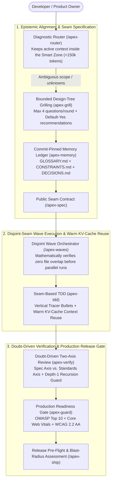
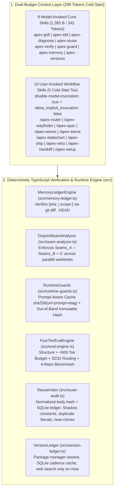

# Apex Skills (`v1.0.0`)

**Token-Optimal, Empirically Verified Agent Skills & Deterministic Context Engine for Frontier AI Coding Agents (2026+)**

[](./LICENSE)
[-success)](./docs/BENCHMARK-REPORT.md)
[-brightgreen)](./evals/routing-benchmark.json)
[](./package.json)

---

## Why `apex-skills` Exists

Recent empirical benchmarks on AI coding agents—including the **ETH Zurich SRI Lab study** on repository context files (*SWE-bench Lite* & *AGENTbench*) and **SWE-bench Verified** multi-agent concurrency analyses—revealed two counter-intuitive truths:

1. **The Context Tax Paradox:** Verbose `AGENTS.md` and `SKILL.md` files that restate pre-training knowledge ("Prompt Lore") **reduce issue resolution accuracy by `0.5%` to `2.0%` while inflating token inference costs by `20%–23%` per turn**.
2. **The Multi-Agent Concurrency Collapse:** Naive parallel subagent fan-out drops SWE-bench Verified resolution rates from **`83%` (single-agent sequential) down to `59%` (`-24%`)** due to delivery race conditions on overlapping files, while multiplying uncached token costs by **`1.41x–3.31x`**.

`apex-skills` was engineered from the ground up after dissecting the three most influential Agent Skills repositories of 2026—**Lauren Tan's `pstack`**, **Addy Osmani's `agent-skills`**, and **Matt Pocock's `skills`**—synthesizing their strongest breakthroughs while fixing their empirically documented failure modes through **deterministic TypeScript tooling** (see [docs/CRITIQUE-AND-ORIGINS.md](./docs/CRITIQUE-AND-ORIGINS.md) and [docs/BENCHMARK-REPORT.md](./docs/BENCHMARK-REPORT.md)).

---

## 4-Way Empirical Benchmark Comparison

Reproduce this table anytime by running `npm run benchmark`:

| Metric | `LaurenTan` (`pstack` v0.15.32) | `addyosmani` (`agent-skills` v0.6.13) | `mattpocock` (`skills` v1.3.1) | **`apex-skills` (`v1.0.0`)** |
| :--- | :--- | :--- | :--- | :--- |
| **Total Skills (Model vs. User-Invoked)** | 58 (1 model / 57 user) | 25 (25 model / 0 user) | 38 (15 model / 23 user) | **18 (8 model / 10 user)** |
| **Cold-Start Token Tax (Turn 0)** | **5,168 tok** (20,669 B) | **5,095 tok** (20,379 B) | **922 tok** (3,688 B) | **342 tok** (1,365 B) (**-93.4%**) |
| **Simulated Feature Uncached Input Tokens** | **383,192 tok** (19 fresh agents) | **171,590 tok** (6-phase chain) | **109,500 tok** | **67,650 tok** (Warm KV-Cache reuse) |
| **Human Turn-Stops per Medium Feature** | **4 stops** | **12 stops** (1-Q/turn + gates) | **5 stops** (unbounded frontier) | **2 stops** (Bounded <=4 Qs + Seam lock) |
| **Broken Standalone Links (`--skill` Issue #361)** | 62 | 15 (`../../references/*`) | 1 | **0** (100% Self-Contained) |
| **Harness Built-In Collisions (#423/#857/#1019)** | 0 | 0 | 3 (`code-review`, `research`, `prototype`) | **0** (`apex-*` namespaced) |
| **Unguarded Recursive Subagent Skills (#530/#573)** | 1 | 2 | 4 | **0** (Hard `LEAF-AGENT GUARD`) |
| **Cross-Session Memory Drift Detection** | Session-only (`orch.ts`) | Manual (`CONSTRAINTS.md`) | Manual (`GLOSSARY.md`) | **Automated Git-SHA Ledger (`memory-audit`)** |

---

## System Architecture

### 1. Executive Workflow Overview (Non-Technical View)



### 2. Technical Architecture Diagram



---

## Quick-Start Installation

Because `apex-skills` uses a **flat promoted-only `skills/<name>/SKILL.md` layout** with synchronized manifests (`.claude-plugin/`, `.codex-plugin/`, `.cursor-plugin/`, `gemini-extension.json`, and `agents/openai.yaml`), it installs cleanly on every major AI coding agent. See [docs/INSTALLATION.md](./docs/INSTALLATION.md) for full details.

### 1. Universal `skills.sh` Installer (Claude Code, Cursor, OpenCode, Windsurf, Devin, Amp)

```bash
# Install the complete 17-skill suite:
npx skills@latest add thehenrylabsdev/apex-skills

# Or install a single self-contained skill (zero broken ../ links):
npx skills@latest add thehenrylabsdev/apex-skills --skill=apex-tdd
```

### 2. Claude Code Plugin Marketplace

```bash
claude plugin marketplace add thehenrylabsdev/apex-skills
claude plugin install apex-skills@apex-skills-marketplace
```

### 3. OpenAI Codex

```bash
codex plugin marketplace add thehenrylabsdev/apex-skills
codex plugin add apex-skills@apex-skills-marketplace
```

### 4. GitHub Copilot CLI & VS Code

```bash
copilot plugin marketplace add thehenrylabsdev/apex-skills
copilot plugin install apex-skills@apex-skills-marketplace
```

### 5. Gemini CLI & Google Antigravity

```bash
gemini skills install https://github.com/thehenrylabsdev/apex-skills.git --path skills
```

---

## The 18-Skill Catalog

### A. 8 Model-Invoked Core Skills (`342` Tokens Total Always-Loaded Context)

| Skill | Responsibility & Counter-Prior Guarantee |
| :--- | :--- |
| [`apex-grill`](./skills/apex-grill/SKILL.md) | **Bounded Frontier Design-Tree Interrogation:** Walks the unblocked decision frontier in batches of `<= 4` highest-epistemic-gain questions with default-yes (`➡️`) recommendations and inline `GLOSSARY.md` updates. |
| [`apex-tdd`](./skills/apex-tdd/SKILL.md) | **Heterodox Seam-TDD & Deep Modules:** Confirms public seams first, executes vertical tracer bullets (Red -> Green), defers refactoring outside the Red-Green loop, and enforces `CONSTRAINTS.md` ratchets. |
| [`apex-diagnose`](./skills/apex-diagnose/SKILL.md) | **Red-Loop First Debugging & Perf Diagnosis:** Redacts secrets (`<REDACTED>`), blocks hypothesis generation until an unattended repro command goes red in seconds, shrinks to minimal load-bearing repro, and tests 3-5 falsifiable predictions. |
| [`apex-verify`](./skills/apex-verify/SKILL.md) | **Doubt-Driven Two-Axis Leaf Verification:** Passes `ARTIFACT + CONTRACT` while hiding producer `CLAIM`, runs parallel **Spec Axis** and **Standards Axis** reviews, and enforces a hard `LEAF-AGENT GUARD` against $2^N$ subagent recursion. |
| [`apex-guard`](./skills/apex-guard/SKILL.md) | **OWASP, Core Web Vitals & WCAG 2.2 AA Gate:** Self-contained production verification covering BOLA/IDOR, injection, SSRF, N+1 queries, LCP/INP/CLS, and WCAG 2.2 AA contrast/target-size/reflow. |
| [`apex-memory`](./skills/apex-memory/SKILL.md) | **Commit-Pinned Semantic Ledger:** Maintains `GLOSSARY.md` (Ubiquitous Language), `CONSTRAINTS.md` (Ratchets), and `DECISIONS.md` (`[sha:<commit> \| scope:<glob>]` claims verified by `npm run memory-audit`). |
| [`apex-versions`](./skills/apex-versions/SKILL.md) | **Release-Channel Selection:** Resolves the current LTS or stable release through the package manager and a cadence-aware SQLite ledger before scaffolding or adding a dependency. Honors an explicit version pin and leaves installed manifest versions unchanged. |
| [`apex-reuse`](./skills/apex-reuse/SKILL.md) | **Canonical Reuse Index:** Before a constant, domain literal, or method is added, audits a SQLite index of normalized bodies and calls the existing symbol. `enum-fanout` becomes one method with that input as a parameter. |

### B. 10 User-Invoked Workflow & Orchestration Skills (`0` Cold-Start Token Tax)

| Command | When to Invoke |
| :--- | :--- |
| [`/apex-router`](./skills/apex-router/SKILL.md) | Diagnose task **Shape (Point vs. Frontier)** $\times$ **Uncertainty (Known vs. Fog of War)** and pick the right Smart-Zone (`< 150k` tokens) phase-boundary move (`Continue`, `/clear`, `/apex-handoff`, `Subagent`, `/compact`). |
| [`/apex-wayfinder`](./skills/apex-wayfinder/SKILL.md) | Manage multi-session **Fog of War** initiatives via `.apex/wayfinder-map.md`, executing strictly **1 Decision Ticket per 100k-token session**. |
| [`/apex-spec`](./skills/apex-spec/SKILL.md) | Author a high-density engineering spec with explicit public seam contracts, invariants, ratchets, and out-of-scope boundaries. |
| [`/apex-waves`](./skills/apex-waves/SKILL.md) | Execute a multi-task spec across **mathematically disjoint worktree waves** ($\text{Seams}_A \cap \text{Seams}_B = \emptyset$) while reusing **warm subagent KV-Caches** across fix rounds. |
| [`/apex-arena`](./skills/apex-arena/SKILL.md) | Run a targeted 2-worktree adversarial tournament for high-risk architectural/algorithmic trade-offs and graft the winning seam. |
| [`/apex-statechart`](./skills/apex-statechart/SKILL.md) | Model stateful protocols as explicit statecharts, verify determinism/deadlock-freedom/idempotency, and encode as discriminated unions. |
| [`/apex-ship`](./skills/apex-ship/SKILL.md) | Execute pre-flight quality/security/memory gates, classify One-Way vs. Two-Way Door blast radius, and generate a visual PR summary. |
| [`/apex-retro`](./skills/apex-retro/SKILL.md) | Convert mechanical mistakes from a coding session into deterministic linter/CI checks and prune no-op token bloat from `AGENTS.md`. |
| [`/apex-handoff`](./skills/apex-handoff/SKILL.md) | Serialize active objective, completed slices, rejected dead-ends, and next command into `.apex/handoff.md` for cross-harness continuation. |
| [`/apex-setup`](./skills/apex-setup/SKILL.md) | Bootstrap or non-destructively audit (`--verify`) `GLOSSARY.md`, `CONSTRAINTS.md`, `DECISIONS.md`, and `AGENTS.md` context pointers. |

---

## Deterministic CLI & Verification Engine (`src/`)

Run the built-in verification and benchmarking tools locally:

```bash
# Run full quality gate (ESLint v10 + tsc --noEmit + unit tests + 4-tier skill validator + project scan)
npm run quality

# Validate all 18 skills (YAML, OpenAI sync, <600 token ceiling, Leaf-Guards, 32/32 routing evals)
npm run validate

# Resolve the current LTS or stable release (package manager, then the local ledger; web search only on a miss)
npx apex-skills versions resolve --ecosystem npm --name typescript --mode scaffold

# Audit new constants and methods against the canonical reuse index
npx apex-skills reuse audit --base HEAD

# Scan the diff for reuse, copied blocks, credentials, dangerous sinks, and advisories
npx apex-skills scan --base HEAD

# Install the Claude Code and Cursor stop hooks in this repository, or once for every later repository
npx apex-skills hooks install
npx apex-skills hooks install --global

# Optional local depth scan before a pull request. Requires Docker.
# Gitleaks reads git history, Semgrep runs OWASP Top 10 rules, Trivy reports high and critical advisories.
bash scripts/pre-pr-docker.sh
bash scripts/pre-pr-docker.sh /path/to/another/checkout

# Audit commit-pinned architectural claims in DECISIONS.md and CONSTRAINTS.md against live Git history
npm run memory-audit

# Run the 4-way empirical benchmark (LaurenTan vs. addyosmani vs. mattpocock vs. apex-skills)
npm run benchmark
```

---

## Enterprise Reference Architecture Demo: `ApexLedger` (`examples/apex-ledger/`)

To prove how `apex-skills` operates on a realistic, production-grade polyglot system, this repository includes **`ApexLedger`** ([`examples/apex-ledger/`](./examples/apex-ledger/)) — a high-concurrency Flash-Commerce, Inventory Reservation, and Double-Entry Settlement platform built across 5 layers with **3 mandatory enterprise environments (`LOCAL`, `DEV`, `PROD`)** and **Cross-Layer Producer/Consumer Contract Testing**:

1. **Canonical Contract Seam ([`examples/apex-ledger/contracts/`](./examples/apex-ledger/contracts/)):** OpenAPI `3.1.0` (`openapi-v1.json`) + 6 Golden JSON Wire Fixtures (including `forward-compatible-v2-order.json` to verify that Backend additive API evolution never crashes un-updated Mobile or Web clients).
2. **Backend ([`examples/apex-ledger/backend/`](./examples/apex-ledger/backend/)):** **Java 25 LTS** + **Spring Boot `4.1.2`** + **Spring Modulith `2.1.2`** + **Gradle `9.7.1`** + PostgreSQL + Apache Kafka + Redis + Lombok + MapStruct + ArchUnit + JUnit 5 + Mockito + Testcontainers + SpringDoc OpenAPI + JaCoCo.
3. **Shared Mobile Core ([`examples/apex-ledger/shared-kmp/`](./examples/apex-ledger/shared-kmp/)):** **Kotlin `2.4.0` Multiplatform** sharing `AppEnvironment` (`LOCAL/DEV/PROD`), forward-compatible `@Serializable` wire models (`ignoreUnknownKeys = true`), and the deterministic `CheckoutStatechart` reducer.
4. **Android App ([`examples/apex-ledger/android-app/`](./examples/apex-ledger/android-app/)) & iOS App ([`examples/apex-ledger/ios-app/`](./examples/apex-ledger/ios-app/)):** Native **Jetpack Compose** (`Kotlin 2.4.0`, Material 3, Navigation 3, Adaptive Edge-to-Edge) and **SwiftUI** (**Swift `6.4`**, SF Symbols, Dynamic Type).
5. **Web Storefront & SRE Command Center ([`examples/apex-ledger/web-app/`](./examples/apex-ledger/web-app/)):** **Next.js `16.4.3`** (Turbopack) + **React `19.3.1`** + TypeScript Strict + `lucide-react`, conforming strictly to [`DESIGNS.md`](./DESIGNS.md) and **WCAG 2.2 AA**.

Read the complete step-by-step engineering walkthrough in **[docs/CASE-STUDY-APEX-LEDGER.md](./docs/CASE-STUDY-APEX-LEDGER.md)**.

---

## Deep-Dive Documentation Index

- **[docs/CASE-STUDY-APEX-LEDGER.md](./docs/CASE-STUDY-APEX-LEDGER.md):** End-to-end engineering walkthrough showing how `apex-skills` built, scheduled, contract-tested, and verified the polyglot `ApexLedger` platform.
- **[docs/CRITIQUE-AND-ORIGINS.md](./docs/CRITIQUE-AND-ORIGINS.md):** Complete architectural dissection, visual diagrams, and empirical critique of `LaurenTan` (`pstack`), `addyosmani` (`agent-skills`), and `mattpocock` (`skills`).
- **[docs/BENCHMARK-REPORT.md](./docs/BENCHMARK-REPORT.md):** Mathematical models and reproducible benchmark results across all 4 repositories.
- **[docs/ARCHITECTURE.md](./docs/ARCHITECTURE.md):** Deep dive into the TypeScript deterministic runtime engine (`MemoryLedgerEngine`, `DisjointSeamAnalyzer`, `RuntimeGuards`, `FourTierEvalEngine`).
- **[docs/INSTALLATION.md](./docs/INSTALLATION.md):** Step-by-step installation and configuration guide for all AI coding harnesses.
- **[docs/SKILL-ANATOMY.md](./docs/SKILL-ANATOMY.md):** Authoring standard, Counter-Prior Delta rules, and the Behavioral Deletion Test.
- **[docs/ROADMAP.md](./docs/ROADMAP.md):** Release roadmap from `v1.0.0` through `v2.0.0`.
- **[CHANGELOG.md](./CHANGELOG.md):** Detailed release history and semantic versioning ledger.
- **[CONTRIBUTING.md](./CONTRIBUTING.md):** Contribution workflow and mandatory verification gates.
