# Deterministic Engine Architecture (`docs/ARCHITECTURE.md`)

Unlike traditional Agent Skills repositories that rely solely on prose instructions, **`apex-skills`** pairs its 18-skill catalog with a zero-dependency, strictly typed TypeScript verification and runtime engine (`src/`).

```mermaid
classDiagram
    class MemoryLedgerEngine {
        +matchesScopePattern(filePath, scopePattern) boolean
        +parseMemoryPinEntries(markdownContent, sourceFile) MemoryPinEntry[]
        +evaluateMemoryEntries(entries, changedFilesBySha) MemoryAuditReport
        +auditRepositoryMemory(repoRoot, relativeFiles) MemoryAuditReport
    }

    class DisjointSeamAnalyzer {
        +seamsOverlap(seamA, seamB) boolean
        +findTaskSeamConflict(taskA, taskB) SeamConflict
        +scheduleDisjointWaves(tasks) WaveScheduleResult
        +simulateKvCacheEconomics(input) KvCacheSimulationComparison
    }

    class RuntimeGuards {
        +canonicalizeUrl(rawUrl) string
        +computePromptAwareCacheKey(input) string
        +extractImmutableSignatures(sourceCode) ImmutableBlockSignature[]
        +verifyImmutableBlocksUnchanged(beforeSource, afterSource) SignatureVerificationResult
    }

    class ReuseIndex {
        +extractReuseSymbols(file, source) ReuseSymbol[]
        +auditReuse(candidates, pool, options) ReuseAuditReport
        +selectCandidateSymbols(baseline, current) ReuseSymbol[]
    }

    class ProjectScan {
        +runProjectScan(request, io) ScanReport
        +installProjectHooks(root) string[]
        +replyForHook(report, input) HookReply
    }

    class FourTierEvalEngine {
        +parseSkillDirectory(skillDirPath) SkillMetadata
        +discoverSkills(skillsRoot) SkillMetadata[]
        +scorePromptAgainstSkills(prompt, modelInvokedSkills) RankedSkill[]
        +validateSkillCatalog(skillsRoot, evalCases, tokenCeiling) CatalogValidationReport
    }

    FourTierEvalEngine --> DisjointSeamAnalyzer : uses for benchmark simulation
```

---

## 1. `MemoryLedgerEngine` (`src/memory-ledger.ts`)
Solves the **Cross-Session Memory Drift** problem acknowledged as unsolved across all prior skill frameworks:
- Parses `[sha:<commit_sha> | scope:<glob_list>]` claims from `DECISIONS.md` and `CONSTRAINTS.md`.
- Executes `git cat-file -e <sha>^{commit}` and `git diff --name-only <sha>..HEAD`.
- Matches modified files against `<glob_list>` (`matchesScopePattern`) and flags each claim as `VALID`, `DRIFTED` (with exact file names), or `UNVERIFIABLE_SHA`.

## 2. `DisjointSeamAnalyzer` (`src/seam-analyzer.ts`)
Prevents **Multi-Agent Delivery Race Conditions** (which caused a `-24%` accuracy drop on SWE-bench Verified):
- Accepts a DAG of `TaskNode` items with `dependsOn` and `touchedSeams`.
- Performs topological wave scheduling while checking `findTaskSeamConflict(taskA, taskB)`.
- If two ready tasks touch overlapping files or glob prefixes, they are automatically serialized into separate waves (`serializedConflicts`), guaranteeing $\text{Seams}_A \cap \text{Seams}_B = \emptyset$ inside every parallel worktree wave.

## 3. `RuntimeGuards` (`src/runtime-guards.ts`)
Replaces fragile bash hooks with deterministic, non-destructive cryptographic verification:
- **`computePromptAwareCacheKey`**: Hashes `canonicalUrl + "\0" + normalizedPrompt + "\0" + etag + "\0" + lastModified` via SHA-256 so two different extraction prompts against the same URL never poison each other's cache entry.
- **`verifyImmutableBlocksUnchanged`**: Extracts `@immutable-start ... @immutable-end` and `@simplify-ignore-start ... @simplify-ignore-end` blocks in memory and compares SHA-256 digests before and after edits—never mutating user files on disk during `PreToolUse`.

## 4. `FourTierEvalEngine` (`src/eval-engine.ts`)
Enforces 4 automated verification gates on every commit:
- **Tier 1 (Structure, Invocation Graph & Portability):** Checks YAML frontmatter, `agents/openai.yaml` policy parity, zero `../` links, valid `Skill` tool targets (`disableModelInvocation === false`), and mandatory `LEAF-AGENT GUARD` clauses.
- **Tier 2 (Token Budget Ratchets):** Enforces `<= 600` tokens total cold-start frontmatter and `<= 1,800` tokens per skill file.
- **Tier 3 (Namespace Collision & 32/32 Adversarial Routing):** Verifies zero collisions with built-in harness commands and `100%` Rank-1 routing accuracy on `evals/routing-benchmark.json`.

## 5. `VersionLedger` (`src/version-ledger.ts`)

Stops new scaffolds and new dependencies from inheriting a training-cutoff release:

1. **Explicit Version Pin** and **Manifest Hold** return immediately, with no registry call.
2. A SQLite **Version Ledger** entry younger than one observed stable release cycle is authoritative.
3. A missing or cadence-expired entry is refreshed through the ecosystem package manager (`npm`, `go`, `uv`) or the registry endpoint behind it (Maven Central, PyPI, crates.io, the Node.js index, Adoptium, the Rust stable channel).
4. Host language and framework versions already chosen filter that channel: the recommended release is kept when its declared peers, engines, and developed-against constraints accept them, otherwise the newest older stable release that does.
5. A web search is requested only when those probes return nothing. `versions record` writes the search result back so the next resolve hits the ledger until the next release cycle.
- **Tier 4 (`src/benchmark.ts`):** Computes reproducible cross-repository metrics across `LaurenTan`, `addyosmani`, `mattpocock`, and `apex-skills`.

## 6. `ReuseIndex` (`src/reuse-extract.ts`, `src/reuse-audit.ts`, `src/reuse-ledger.ts`)

Stops a new constant or near-clone method from landing beside an existing symbol:

1. Extract string constants, domain literals, and method bodies from Java, Kotlin, TypeScript, JavaScript, and Python.
2. Normalize each method body: comments drop, identifiers become one token, literals collapse, control-flow keywords stay. Hash the token sequence.
3. Persist the symbols in a repository SQLite ledger keyed by file content hash. An extractor version bump rebuilds the ledger.
4. `reuse audit --base <ref>` reports only symbols that are new relative to that ref. `SHADOW_CONSTANT`, `DUPLICATE_LITERAL`, and `NEAR_CLONE` (`enum-fanout` or `same-body`) fail the audit. The message names the canonical symbol to call. Same-body clones enter at 12 normalized tokens. Enum fan-out enters at 8.
5. Retrieval stacks (tree-sitter, LSP, embeddings) can suggest a file. They do not decide the verdict. The hash does.

## 7. `ProjectScan` (`src/scan-run.ts`, `src/scan-hooks.ts`)

Stops an agent from finishing a change in any repository until one local command passes:

1. `scan` reuses the Canonical Reuse Index, then reads added diff lines for copied token blocks, credential patterns, and dangerous sinks, and audits a changed dependency manifest.
2. npm manifests run `npm audit` at high and critical. An unlocked Gradle, Maven, Go, Rust, Python, Composer, NuGet, Ruby, or Swift manifest fails until a lockfile sits beside it. Resolved Go, Rust, Python, Composer, NuGet, and Ruby versions are queried at `api.osv.dev`. An advisory, or an unreachable query, fails the scan.
3. `sonar-scanner` and `gitleaks` run only after the repository opts in. A configured binary that is missing fails the scan.
4. `hooks install` commits a Claude Code Stop hook and a Cursor stop hook. Claude Code exits `2` and Cursor returns `followup_message`, so the agent continues until the report is `PASS`.
