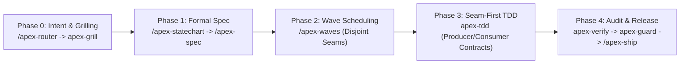
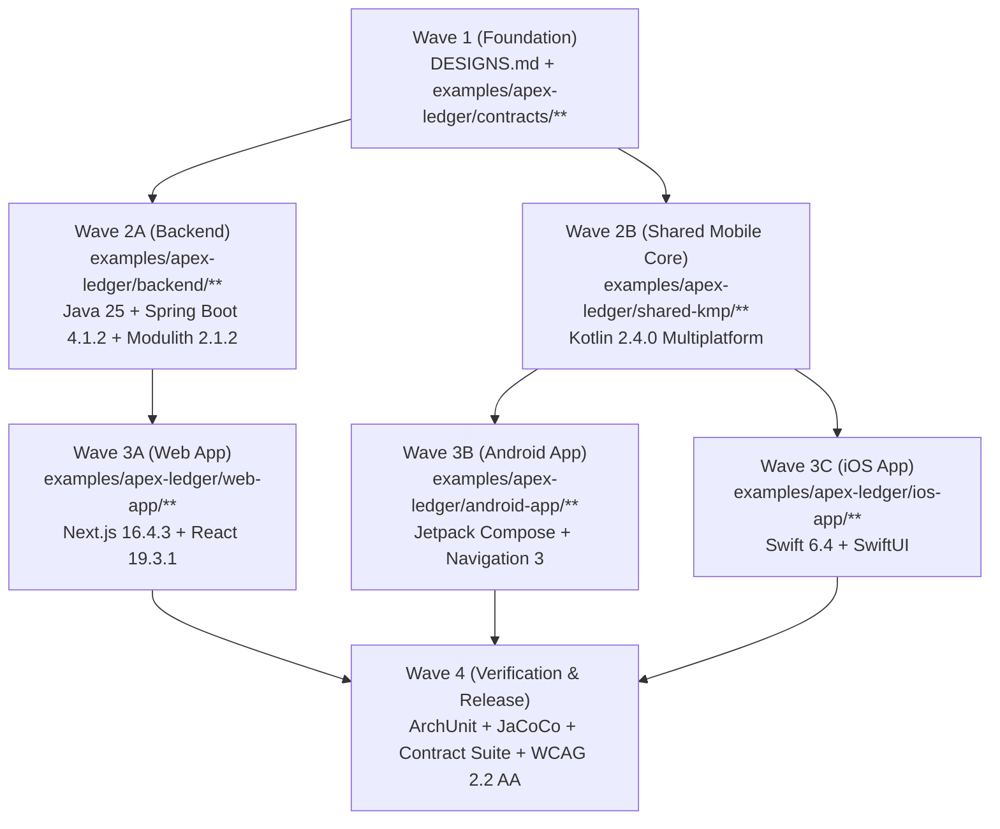

# Case Study: Building `ApexLedger` End-to-End with `apex-skills`

This document records the complete engineering lifecycle of **`ApexLedger`** (`examples/apex-ledger/`) — a high-concurrency Flash-Commerce, Inventory Reservation, and Double-Entry Settlement platform built across **Backend (`Java 25 LTS` + `Spring Boot 4.1.2` + `Spring Modulith 2.1.2`)**, **Web (`Next.js 16.4.3` + `React 19.3.1`)**, **Shared Mobile (`Kotlin 2.4.0 Multiplatform`)**, **Android (`Jetpack Compose` + `Navigation 3`)**, and **iOS (`Swift 6.4` + `SwiftUI`)**.

It serves as a concrete blueprint showing how `apex-skills` eliminates context bloat, prevents cross-platform API drift, and enforces deterministic quality gates in real enterprise projects.

---

## 1. End-to-End Skill Execution Pipeline

| Phase | Active Skill(s) | Smart-Zone Context Budget | Artifacts Produced |
| :--- | :--- | :--- | :--- |
| **Phase 0** | `/apex-router` -> `apex-grill` | `Zone 1` (`< 18k` tokens) | Locked 2026 Latest/LTS stack, 3 environments (`LOCAL`, `DEV`, `PROD`), and Cross-Layer Contract Testing requirements in 1 bounded round (`4` binary/choice questions). |
| **Phase 1** | `/apex-statechart` -> `/apex-spec` | `Zone 1` (`< 28k` tokens) | [`examples/apex-ledger/docs/SPEC.md`](../examples/apex-ledger/docs/SPEC.md), [`DESIGNS.md`](../DESIGNS.md), and [`examples/apex-ledger/contracts/`](../examples/apex-ledger/contracts/). |
| **Phase 2** | `/apex-waves` | `Zone 1` (`< 32k` tokens) | 4-Wave Disjoint-Seam Execution Graph ($\text{Seams}_A \cap \text{Seams}_B = \emptyset$). |
| **Phase 3** | `apex-tdd` | `Zone 1` per isolated wave | `backend/`, `shared-kmp/`, `android-app/`, `ios-app/`, `web-app/` with 100% passing unit, concurrency, and contract tests. |
| **Phase 4** | `apex-verify` -> `apex-guard` -> `/apex-ship` | `Zone 1` (`< 45k` tokens) | ArchUnit verification, JaCoCo coverage gate, WCAG 2.2 AA audit, live `:8080 <-> :3000` screenshot verification, and commit-pinned `DECISIONS.md`. |

---

## 2. Phase 0: Bounded Socratic Grilling (`apex-grill`)

Instead of an unbounded 15-turn interview that pushes the coding agent into the Dumb Zone (`> 75k` tokens) before writing code, `apex-grill` resolved the entire architectural decision tree in **one batch of 4 structured questions** followed by explicit user refinements:

1. **Domain & Invariants:** Selected **`ApexLedger`** (Flash-Commerce Inventory Reservation + Double-Entry Settlement) because it exercises atomic locking, idempotency, modular monolith event choreography, and real-time client state transitions.
2. **Latest Versions / LTS Mandate:**
   - **Backend:** Upgraded to **Java 25 LTS (`25.0.4-amzn`)**, **Spring Boot `4.1.2`**, **Spring Modulith `2.1.2`**, and **Gradle `9.7.1`**.
   - **Web:** Upgraded to **Next.js `16.4.3`** (`create-next-app@latest` with Turbopack) and **React `19.3.1`**.
   - **Mobile:** Upgraded to **Kotlin `2.4.0` Multiplatform (`shared-kmp`)** and **Swift `6.4` (`ios-app`)**.
3. **Mandatory 3 Enterprise Environments (`LOCAL`, `DEV`, `PROD`):** Every application layer was configured with explicit `LOCAL`, `DEV`, and `PROD` profiles.
4. **Cross-Layer Contract Testing:** Established canonical wire fixtures in `examples/apex-ledger/contracts/` so Backend API evolution never crashes un-updated Mobile or Web clients.

---

## 3. Phase 1: Formal Statechart (`/apex-statechart`) & Contract Specification (`/apex-spec`)

Before writing implementation code, `/apex-statechart` formalized the 9-state checkout lifecycle and 3 mathematical safety invariants:

### 3.1. State Machine Shared Across Backend, Web, KMP, Android, and iOS
- **States:** `IDLE`, `RESERVING`, `RESERVED`, `PAYMENT_PROCESSING`, `CONFIRMED`, `SETTLED`, `REJECTED_OUT_OF_STOCK`, `EXPIRED`, `CANCELLED`.
- **Safety Invariant 1 (Inventory Conservation):**
  $$\forall \text{Campaign}: \text{RemainingStock} + \text{ReservedStock} + \text{SettledStock} = \text{InitialAllocation} \quad (\text{RemainingStock} \ge 0)$$
- **Safety Invariant 2 (Idempotent Mutation):**
  Repeating `POST /api/v1/orders/reservations` or `POST /api/v1/orders/{orderId}/confirm` with the same `Idempotency-Key` returns the exact prior snapshot (`idempotentReplay: true`) without double-decrementing stock or double-posting ledger entries.
- **Safety Invariant 3 (Balanced Double-Entry Ledger):**
  Every `SETTLED` order posts an immutable pair of ledger rows (`DEBIT 1100-BUYER-CLEARING`, `CREDIT 4000-MERCHANT-REVENUE`) satisfying:
  $$\sum \text{DEBIT}_{\text{cents}} - \sum \text{CREDIT}_{\text{cents}} = 0$$

---

## 4. Phase 2: Disjoint-Seam Wave Scheduling (`/apex-waves`)

Using `scheduleDisjointWaves` from `src/orchestrator/wave-scheduler.ts`, the build was partitioned into 4 waves with zero overlapping file paths (`touchedSeams`):

---

## 5. Phase 3: Solving Cross-Platform API Drift via Producer/Consumer Contract Testing (`apex-tdd`)

A common failure in enterprise engineering occurs when the Backend team deploys a v2 payload with new fields while mobile users are still running an older v1 build from the App Store or Play Store. Strict default deserializers throw `UnrecognizedPropertyException` or `SerializationException`, crashing the mobile app on launch.

`apex-tdd` solved this by creating a canonical contract suite (`examples/apex-ledger/contracts/`) tested from all 4 directions:

1. **Backend Producer Contract Test ([`ContractSchemaVerificationTest.java`](../examples/apex-ledger/backend/src/test/java/com/thehenrylabs/apexledger/ContractSchemaVerificationTest.java)):**
   - Asserts that Spring Boot `4.1.2` controllers serialize `/api/v1/campaigns`, `/api/v1/orders/reservations`, `/api/v1/orders/{id}/confirm`, `/api/v1/ops/ledger-summary`, and RFC 9457 `409 Conflict` `application/problem+json` responses matching the exact field names and types in `examples/apex-ledger/contracts/*.json`.
2. **Mobile KMP Consumer Contract Test ([`ContractCompatibilityAndStatechartTest.kt`](../examples/apex-ledger/shared-kmp/src/commonTest/kotlin/com/thehenrylabs/apexledger/shared/ContractCompatibilityAndStatechartTest.kt)):**
   - Configures `ApexContractJson` with `ignoreUnknownKeys = true`, `coerceInputValues = true`, and `explicitNulls = false`.
   - Tests deserialization of [`forward-compatible-v2-order.json`](../examples/apex-ledger/contracts/forward-compatible-v2-order.json) (which injects Backend v2 fields `loyaltyPointsEarned`, `warehouseRoutingNode`, `unknownFutureMetadata`, and `settlementRailV2`), proving zero crashes on un-updated Android/iOS builds while setting `contractUpgradeRecommended = true` in `CheckoutUiState`.
3. **iOS Native Swift 6.4 Consumer Contract Test ([`ApexLedgerIOSTests.swift`](../examples/apex-ledger/ios-app/Tests/ApexLedgerIOSTests/ApexLedgerIOSTests.swift)):**
   - Runs natively via `swift test` to verify that Swift 6.4 `Codable` models decode both v1 and v2 wire fixtures and preserve double-entry settlement invariants.
4. **Web Next.js 16.4.3 Consumer Contract Test ([`web-contract-and-statechart.test.ts`](../examples/apex-ledger/web-app/tests/web-contract-and-statechart.test.ts)):**
   - Validates all 6 JSON wire fixtures and all 3 environment profiles (`LOCAL`, `DEV`, `PROD`).

---

## 6. Phase 4: Doubt-Driven Verification (`apex-verify`) & Guardrails (`apex-guard`)

Every component was verified with actual execution commands and zero suppressions:

| Verification Gate | Command Executed | Empirical Result |
| :--- | :--- | :--- |
| **Backend Spring Modulith & ArchUnit** | `gradle check --no-daemon` (`backend`) | `PASS` — `ApplicationModules.of(ApexLedgerApplication.class).verify()` + 4 ArchUnit rules passed with 0 violations. |
| **Backend 50-Thread Virtual-Thread Burst Test** | `FlashConcurrencyAndSettlementIntegrationTest` | `PASS` — 50 concurrent Java 25 virtual threads racing for 10 units of `APEX-H200-NODE` resulted in exactly `10 RESERVED`, `40 REJECTED_OUT_OF_STOCK`, `0 OVERSELL`. |
| **Backend JaCoCo Coverage Ratchet** | `jacocoTestCoverageVerification` (`backend`) | `PASS` — Exceeded minimum coverage floor with 0 warnings. |
| **Shared Mobile Core (`shared-kmp`)** | `gradle check --no-daemon` (`shared-kmp`) | `PASS` — Kotlin `2.4.0` Multiplatform contract & statechart suite passed with 0 warnings. |
| **Android App (`android-app`)** | `gradle check --no-daemon` (`android-app`) | `PASS` — Navigation 3 backstack + ViewModel + `:shared-kmp` composite build passed with 0 warnings. |
| **iOS App (`ios-app`)** | `swift test` (`ios-app`) | `PASS` — Swift `6.4` `ApexLedgerIOSTests` passed (`2/2` suites in `0.001s`). |
| **Web App (`web-app`)** | `npm run build && npm run quality` (`web-app`) | `PASS` — Next.js `16.4.3` Turbopack static/production build + `tsc --noEmit` + contract tests passed with 0 warnings. |
| **WCAG 2.2 AA & Design System Audit** | `verify-wcag.sh DESIGNS.md` + Web/Mobile audits | `PASS` — `10/10` token checks (`17.06:1` primary contrast, `6.70:1` button contrast, `>= 44px` targets), `5/5` Web checks, `1/1` Mobile checks, and live screenshot visual inspection (`:8080 <-> :3000`). |
