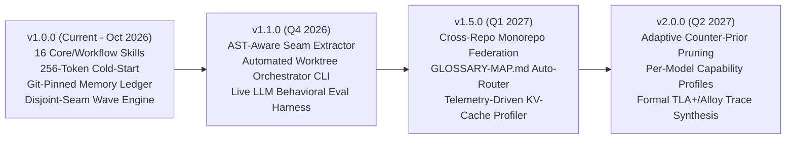

# Product & Architecture Roadmap (`docs/ROADMAP.md`)

This roadmap outlines the planned evolution of **`apex-skills`** from `v1.0.0` through `v2.0.0`. Every milestone is gated by empirical token-efficiency and behavioral adherence benchmarks.

---

## Milestone `v1.0.0` — Foundation & Empirical Synthesis (Completed)
- [x] Flat multi-harness skill architecture (`Claude Code`, `Codex`, `Copilot`, `Cursor`, `Gemini CLI`, `Antigravity`, `skills.sh`).
- [x] Dual-budget context split: 6 Model-Invoked skills (`256` tokens cold-start) + 10 User-Invoked workflow skills (`0` token tax).
- [x] `MemoryLedgerEngine` (`[sha:<commit> | scope:<glob>]` drift detection via `git diff`).
- [x] `DisjointSeamAnalyzer` ($\text{Seams}_A \cap \text{Seams}_B = \emptyset$ wave scheduling + KV-Cache warm reuse simulation).
- [x] `RuntimeGuards` (Prompt-aware cache hashing + non-destructive `@immutable` block verification).
- [x] 4-Tier CI Validator & 4-Repo Head-to-Head Benchmark Suite.

## Milestone `v1.4.0` — Project Scan (Completed)
- [x] `apex-skills scan` is the gate for every repository: canonical reuse, credentials, and high or critical advisories on a changed manifest.
- [x] `apex-skills hooks install` blocks Claude Code and Cursor from ending a turn until the scan passes. `--global` covers later repositories on that machine.

## Milestone `v1.3.0` — Canonical Reuse Index (Completed)
- [x] `apex-reuse` and `apex-skills reuse audit` reject a new shadow constant, duplicate domain literal, or near-clone method, including enum fan-out.
- [x] Repository SQLite ledger keyed by file content hash. The verdict is the normalized body hash.

## Milestone `v1.2.0` — Release-Channel Ledger (Completed)
- [x] `apex-versions` selects the current LTS or stable release for greenfield scaffolds and new dependencies, with explicit pins and manifest holds.
- [x] SQLite version ledger refreshed from package managers and registries when one observed release cycle has elapsed. Web search runs only after those probes miss.

---

## Milestone `v1.1.0` — Automated Worktree Wave Runner & AST Seam Extractor
- [ ] **`apex-skills wave-run` CLI Command:** Automatically create, branch, test, and fast-forward merge git worktrees for each wave emitted by `scheduleDisjointWaves()`.
- [ ] **Static Import-Graph Seam Extractor:** Parse TypeScript/Python/Go import graphs to automatically populate `touchedSeams` from a spec's target symbols without manual glob listing.
- [ ] **Live Headless Harness Runner (`evals/live/`):** Optional CI matrix executing headless `claude -p` and `codex` runs to track behavioral adherence alongside deterministic routing evals.

---

## Milestone `v1.5.0` — Monorepo Federation & KV-Cache Telemetry
- [ ] **Multi-Context `GLOSSARY-MAP.md` Support:** Automatic scoped glossary resolution for large polyglot monorepos (`packages/*`, `services/*`).
- [ ] **KV-Cache Hit-Rate Profiler:** Parse session transcript JSONL logs to report actual cache-read vs. cache-write ratios per skill invocation and flag context-busting tool outputs.
- [ ] **Tracker Sync Adapters:** Optional bidirectional sync between `.apex/wayfinder-map.md` and GitHub Issues (`gh`), GitLab (`glab`), and Linear.

---

## Milestone `v2.0.0` — Model-Adaptive Counter-Prior Pruning
- [ ] **Model-Specific Delta Profiles:** Dynamically strip instructions that newer frontier model checkpoints have internalized, automatically shrinking `SKILL.md` payloads over time.
- [ ] **Executable Statechart Trace Checker:** Verify runtime execution traces against `apex-statechart` transition matrices during integration tests.
